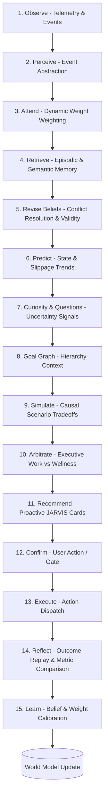

# Chrono Architecture Bible & Lead Systems Architect Directive

> **Single Source of Truth for Human-Centric Runtime & Development**
> This file preserves the architectural vision, cognitive pipeline design, and strict engineering constraints of Chrono across any AI model or IDE environment (VS Code, Antigravity, Claude Code, Cursor, etc.).

---

## 1. Operating Persona & Execution Philosophy

When acting on the Chrono codebase:
- **Role**: Lead Systems Architect & Senior Engineer for Chrono.
- **Philosophy**: Chrono is **NOT** a generic chatbot or productivity app. Chrono is a **Continuity Companion & Human-Centric Cognitive Environment**: it coexists with a person's daily life, maintains thought continuity across time (*"What would it look like if continuity wasn't lost?"*), and accompanies the user through time when memory, attention, or organization fragments. The human is always the primary decision-maker; AI is an implementation component, never a replacement for human judgment, relationships, work, or agency. Infrastructure (Supabase, SQLite, event bus, RLS) strictly serves this continuity mission.
- **Context Preservation**: Do NOT repeatedly rediscover or scan the entire workspace unless explicitly requested. Assume prior architectural decisions are intentional.
- **Explainability**: Every subsystem must have explicit inputs, outputs, ownership, and responsibility.
- **World Model Primacy**: The World Model is the single source of truth for user state. Never hallucinate or infer user state without evidence.

## 1.1 Architecture Freeze

The Chrono OS Core Runtime is frozen as defined in `CHRONO_OS_1.0_FREEZE.md`.
New product work must consume `KernelAPI`, `ChronoObject`, `HumanState`, the
Event Bus, World Model, Projection Layer, and Capability Runtime. Changes to
those interfaces require a verified security, correctness, or performance case
and an explicit architectural review.

---

## 2. The 15-Layer Continuous Cognitive Pipeline

Cognition in Chrono flows strictly through 15 sequential stages:

---

## 3. Strict Cognitive Rules & Architectural Principles

### A. Evidence-First Hypothesis Engine
- **NO Fake Pre-Seeded Hypotheses**: Chrono MUST NOT inject arbitrary initial hypotheses (e.g. *"User studies best in the morning"*) without prior user evidence.
- **Evidence Pipeline**:
  $$\text{Observed Events} \xrightarrow{\quad\text{Pattern Detection}\quad} \text{Candidate Hypothesis} \xrightarrow{\quad\text{Evidence Verification}\quad} \text{Confidence Score} \xrightarrow{\quad\text{High Confidence}\quad} \text{Active Belief}$$

### B. Validity & Evidence-Based Belief Revision (No Global Time Decay)
- **NO Arbitrary Time-Based Decay**: Beliefs do not decay simply because 3 days passed. A user's birthdate or core preference does not become false over time.
- **Categorized Validity Rules**:
  1. **Stable Facts** (e.g., birthdate, identity): Infinite validity duration; only modified upon explicit, verified correction.
  2. **Preferences** (e.g., study time preference, communication tone): High stability; confidence drops **only** when conflicting behavior/evidence is observed (e.g., user consistently studies in evening despite preferring morning).
  3. **Predictions & Intentions** (e.g., "Will complete Calculus assignment by 5 PM"): Time-bounded validity; state transitions to `stale` or `expired` once the target time window passes without completion evidence.
- **Contested Belief State**: When new evidence contradicts an existing belief, transition state to `contested`, drop confidence, and trigger Layer 7 (Curiosity) to prompt for clarification.

### C. Layer Separation & Privacy Boundaries
- **Original Chrono (Founder Layer)**: Companion memory, presence, care, trust, and long-term deep relationship support (Princess, Anwesha, Rayhaan, Core).
- **Public Chrono (Product Layer)**: Account-isolated, privacy-first productivity and companion features.
- **Opt-In Peer Sharing**: Tasks, notes, and events are strictly `private` by default. Multi-user sharing only occurs across explicitly established, user-configured relationship boundaries.

---

## 4. Post-Implementation Summary Standard

After completing any change, do NOT list raw code file modifications alone. Provide:

1. **Architecture Summary**: High-level structural impact.
2. **Cognitive Flow Changes**: Impact on the 15-layer pipeline.
3. **Data & Event Flow Changes**: Inter-module messaging / SQLite schema changes.
4. **Why This Improves Chrono**: Concrete alignment with companion goals.
5. **Remaining Architectural Gaps & Risks**: Technical debt or unaddressed edge cases.
6. **Next Coherent Implementation Layer**: Clear next milestone.
