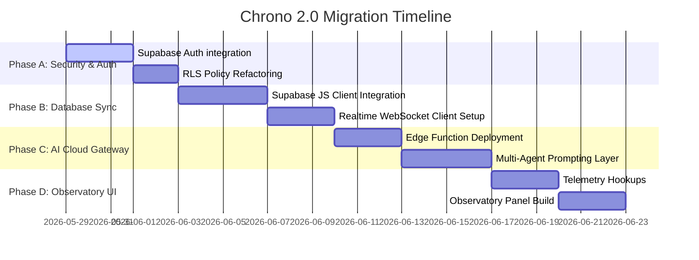

# Chrono 2.0: Collaborative Offline-First Workspace
## Architectural Specification & Security Blueprint

This document defines the architectural specification for transitioning Chrono from a local Direct-to-Supabase client using direct PostgreSQL connection pools with shared secrets to **Chrono 2.0**—a secure, offline-first collaborative AI productivity platform.

```mermaid
graph TD
    subgraph Client Application (Electron Client)
        UI[Renderer Process: Calendar & Chat UI] <--> |IPC Main/Renderer| Main[Main Process: Electron Main Node.js]
        
        subgraph Local Offline Core
            Main <--> |SQLite Client: better-sqlite3| SQLite[(Local SQLite: chrono.db)]
            Main <--> |Cognitive Engine| LocalAI[Local Cognitive Orchestrator]
        end
        
        subgraph Secure Network Client
            SupaClient[Supabase Client Library: @supabase/supabase-js]
            RealtimeSub[WebSocket Realtime Subscriber]
        end
    end

    subgraph Supabase Cloud Gateway
        Auth[Supabase Auth: JWT Generation]
        PostgREST[PostgREST Engine: HTTP REST API]
        RealtimeServ[Supabase Realtime WebSocket Service]
        EdgeFunc[Supabase Edge Functions: AI Cloud Gateway]
    end

    subgraph Database Layer
        RLS[Row-Level Security Policies]
        DB[(Cloud PostgreSQL Database)]
    end

    subgraph Remote AI Foundation
        LLM[Remote LLMs: Gemini, Claude, OpenAI]
    end

    %% Client Interactions
    UI <--> SupaClient
    Main <--> SupaClient
    Main <--> RealtimeSub
    
    %% Network Flows
    SupaClient --> |HTTP HTTPS REST with JWT| PostgREST
    RealtimeSub <--> |Persistent WS connection with JWT| RealtimeServ
    Main --> |API Request| EdgeFunc
    
    %% Cloud Gateways to DB
    Auth --> |User Creation / JWT validation| DB
    PostgREST --> |Claims Checked| RLS
    RealtimeServ --> |Listen to replication streams| DB
    RLS --> |Secure Query Execution| DB
    
    %% AI Edge Function to LLM
    EdgeFunc --> |API Request with Secure API Keys| LLM
```

---

## 1. Addressing the Security Vulnerability (Client-Cloud Connection)

### The Issue in Chrono 1.0:
The application uses Prisma Client directly in the Electron Main process:
```javascript
// cloudDb.js (Chrono 1.0)
const connectionString = process.env.DATABASE_URL; // "postgresql://postgres...password...pooler.supabase.com:6543/postgres"
const pool = new Pool(config);
const adapter = new PrismaPg(pool);
prisma = new PrismaClient({ adapter });
```
This forces the developer to package the database username and password directly inside the desktop client code. If a malicious actor decompiles the application code (which is simple in standard Electron bundles by unpacking the `.asar` file), they extract the master PostgreSQL credentials, granting them unrestricted access to bypass all security controls.

### The Resolution in Chrono 2.0:
We remove the Prisma client, PostgreSQL connection pooler (`pg` Pool), and raw connection strings from the Electron desktop client completely.

The Electron Main process will connect to Supabase through the **Supabase JavaScript Client** (`@supabase/supabase-js`).
1. **Public Key Infrastructure:** The client only utilizes the `SUPABASE_URL` and `SUPABASE_ANON_KEY`, which are safe to expose publicly.
2. **PostgREST Bridging:** Database queries are sent as HTTP requests to Supabase’s PostgREST gateway, which translates REST calls into Postgres queries.
3. **Session-Bound Claims:** The client passes the user's active JSON Web Token (JWT) in the `Authorization` header. The database verifies the JWT, matches claims, and enforces Row-Level Security (RLS).
4. **No Direct DDL/DML Pools:** Database schema updates and migrations are executed exclusively through GitHub Actions or local CLI deployments—never from the application client.

---

## 2. Real Authentication (Supabase Auth)

Instead of maintaining a custom `users` table with password hashes verified via bcrypt in the client, authentication is offloaded to **Supabase Auth**.

```
Client App                   Supabase Auth Service               PostgreSQL Database
   |                                   |                                   |
   |---- 1. Login Request -----------> |                                   |
   |       (Email / OAuth)             |                                   |
   |                                   |---- 2. Create session & token --> |
   |                                   |                                   |
   |<--- 3. Return JWT access_token -- |                                   |
   |                                   |                                   |
   |---- 4. Query with Authorization ->|                                   |
   |       Bearer JWT token            |---- 5. Verify token ------------> |
   |                                   |                                   |
   |                                   |<--- 6. Execute under RLS rules ---|
```

### Auth Workflow:
1. **Login Flow:** The Electron client triggers registration or sign-in using the Supabase library:
   ```javascript
   const { data, error } = await supabase.auth.signInWithPassword({
     email: 'user@example.com',
     password: 'secure_password'
   });
   const token = data.session.access_token;
   ```
2. **Access Token Cache:** The access token is stored locally inside SQLite’s `sync_meta` config table.
3. **Automatic Refresh:** The Supabase client automatically handles token expiration by utilizing the `refresh_token`.
4. **RLS Policies Integration:** RLS rules are updated to map queries using PostgreSQL's native `auth.uid()` hook, matching the user's ID within the Supabase Auth system rather than using custom session claims.

---

## 3. WebSocket Realtime Sync System

To support collaboration and ensure that a change made on a user's mobile device or by a collaborator updates the Electron UI immediately, Chrono 2.0 shifts from a 10-second polling sync engine to **Supabase Realtime**.

```javascript
// main/realtimeSync.js (Chrono 2.0 WebSocket Listener)
const { createClient } = require('@supabase/supabase-js');
const db = require('./main_db');

function initializeRealtimeSync(supabaseUrl, supabaseAnonKey, userJwt) {
    const supabase = createClient(supabaseUrl, supabaseAnonKey, {
        auth: {
            persistSession: false
        }
    });

    // Set the user session to authenticate the websocket listener
    supabase.auth.setSession({ access_token: userJwt, refresh_token: '' });

    const channel = supabase
        .channel('db-changes')
        .on(
            'postgres_changes',
            { event: '*', schema: 'public', table: 'events' },
            (payload) => {
                handleRealtimeUpdate('events', payload);
            }
        )
        .on(
            'postgres_changes',
            { event: '*', schema: 'public', table: 'calendars' },
            (payload) => {
                handleRealtimeUpdate('calendars', payload);
            }
        )
        .subscribe();

    return channel;
}

function handleRealtimeUpdate(table, payload) {
    const { eventType, new: newRecord, old: oldRecord } = payload;
    console.log(`🔔 Realtime Sync [${table}] - Event Type: ${eventType}`);

    if (eventType === 'INSERT' || eventType === 'UPDATE') {
        // Resolve conflicts via newest-wins logic
        const localRecord = db.getLocalRecord(table, newRecord.id);
        if (!localRecord || Number(newRecord.updated_at) > Number(localRecord.updated_at)) {
            db.upsertLocalRecord(table, newRecord);
            // Notify UI to refresh calendars
            notifyRendererOfUpdate(table);
        }
    } else if (eventType === 'DELETE') {
        db.softDeleteLocalRecord(table, oldRecord.id);
        notifyRendererOfUpdate(table);
    }
}
```

---

## 4. AI Cloud Gateway & Multi-Agent System

Currently, the local AI Gateway in `server/ai_gateway.js` uses a mock local engine. In Chrono 2.0, the assistant is transformed into a **Serverless AI Cloud Gateway** running on **Supabase Edge Functions** (built on Deno).

```
Electron Client                  Cloud API Gateway                 LLM Foundation
  (No API Keys)                (Supabase Edge Function)          (Gemini/Claude/OpenAI)
       |                                   |                                   |
       |---- 1. Message + JWT -----------> |                                   |
       |                                   |---- 2. Validate session & JWT --> |
       |                                   |                                   |
       |                                   |---- 3. Route to active agent ---> |
       |                                   |        (Embeds API Keys)          |
       |                                   |                                   |
       |                                   |---- 4. Post prompt to LLM ------> |
       |                                   |                                   |
       |                                   |<--- 5. Return stream / response --|
       |                                   |                                   |
       |<--- 6. Return adapted response ---|                                   |
```

### Advantage:
- **API Key Security:** No third-party LLM API keys (Gemini, Anthropic, or OpenAI keys) are stored in the client. The gateway injects environment-stored keys before forwarding queries.
- **Dynamic Routing:** Requests are routed to specialized AI agents:
  1. **Companion Agent:** Empathetic, supportive, adapts to cognitive overload (low reassurance needs vs. high reassurance needs).
  2. **Architect Agent:** High-density, analytical, reads calendar data, flags scheduling density, and schedules focus hours.
  3. **Focus Guardian Agent:** Intercepts loop queries and prevents burnout.

---

## 5. Chrono Observatory Dashboard

The Observatory is a dedicated diagnostic center inside the UI for tracking system behavior, rendering real-time metrics of the collaborative client.

```
+-----------------------------------------------------------------------------------+
|                                 CHRONO OBSERVATORY                                |
+-----------------------------------------------------------------------------------+
|  [ AI GATEWAY ACTIVITY ]               |  [ SYNC ENGINE ACTIVITY ]                |
|  Active Model: gemini-1.5-flash        |  Sync Status: ONLINE (WebSocket active)  |
|  Total Messages: 142                   |  Last Sync Event: 3 seconds ago          |
|  Average Latency: 320ms                |  Sync Latency (avg): 85ms                |
|  Token Count (Today): 18,240 tokens    |  Conflict Rates: 0.8% (all resolved)     |
|                                        |                                          |
|  +----------------------------------+  |  +------------------------------------+  |
|  | Latency (ms)                     |  |  | Sync Packet Size (kb)              |  |
|  | [|||||||||||||||               ] |  |  | [||                                ] |  |
|  +----------------------------------+  |  +------------------------------------+  |
+-----------------------------------------------------------------------------------+
|  [ CALENDAR TELEMETRY ]                |  [ USER COGNITIVE PROFILES ]             |
|  Active Events: 14                     |  Cognitive Style: Adaptive               |
|  Completed Tasks: 8                    |  Attention Metric: High Focus (2.3 hrs)  |
|  Protected Focus Hours: 12.5 hrs       |  Interaction Rhythm: Regular             |
|  Current Habit Streak: 5 Days          |  System Load State: Optimal              |
+-----------------------------------------------------------------------------------+
```

---

## 6. Implementation Stages (Migration Roadmap)


