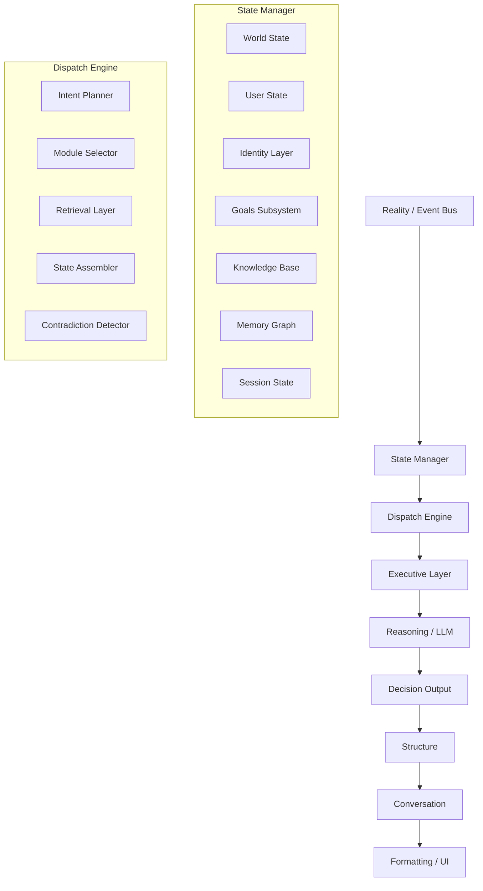

# The Architectural Pipeline

## 1. State Manager Definitions
- **World State:** Objective reality (Calendar, Tasks, Weather).
- **User State:** Persistent characteristics (Energy, Sleep).
- **Identity Layer:** The stable continuity of the person (Name, Preferences, Core values, Mission, Roles, Long-term narratives).
- **Knowledge Base:** Objective facts (Paris is in France).
- **Memory Graph:** User-specific continuity (User visited Paris).
- **Session State:** Ephemeral reality of the active conversation.

## 2. Temporal Architecture
Almost everything depends on time.
- **Past:** Memory Graph
- **Present:** World State, User State
- **Future:** Calendar, Goals
- **Hypothetical:** Reasoning over "what-if" scenarios.

## 3. Trust vs. Confidence
Every retrieved fact possesses both confidence and trust.
- **Confidence:** Likelihood of correctness (e.g., 0.98).
- **Trust:** The source's authority (e.g., Official calendar vs. LLM inference).

## 4. Intent Taxonomy & Executive Decisions
Dispatch classifies *intent* (Inform, Explain, Explore, Plan, Reflect, Retrieve, Compare, Predict, Create, Debug, Teach).
The Executive Layer classifies *decisions* (Information, Planning, Recommendation, Reminder, Automation, Reflection).

## 5. Separation of Cognition & Automation
- **Cognition:** Answers *What should happen?* 
- **Automation:** Answers *Do it.*
Dispatch must never become an automation engine.
